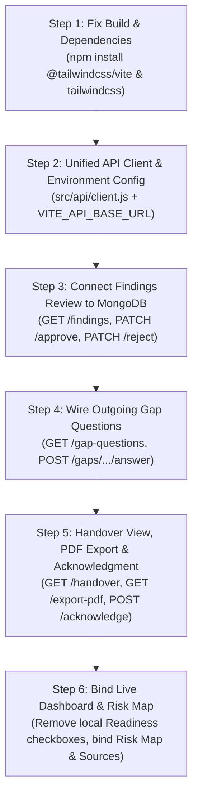

# Sanchaya (सञ्चय) — Comprehensive Frontend Codebase Review

> **Scope:** Full frontend codebase review of `services/frontend` (React 18, Vite, Tailwind CSS).  
> **Reference Documents:** Team EPSILUM Round 1 Proposal (14-page Team Report), Lokesh Pravin Pawar's Frontend Lead Deliverables, `AGENTS.md`, and Backend API Contracts.  
> **Date of Review:** 2026-11-11  
> **Reviewer:** Automated Architecture & Frontend Reviewer  

---

## 1. Executive Summary

Sanchaya's frontend is designed as a role-aware workspace serving three distinct project stakeholders across the 5-stage handover pipeline:
1. **Team Leader:** Ingests sources, triggers knowledge reconstruction, reviews AI-extracted candidate findings alongside source slips, and signs off on handover readiness.
2. **Outgoing Member:** Answers targeted knowledge-gap questions generated from missing/unknown evidence and flags unrecorded decisions.
3. **Incoming Member:** Inspects the verified handover continuation plan, reviews points requiring follow-up, downloads the official PDF export, and acknowledges handover acceptance.

### High-Level Assessment
- **UI Design & Micro-Interactions (Strong):** The visual design system (emerald/forest color palette `#00665D`, `#00ED64`, `#001E2B`, high-contrast typography with Source Serif 4 and Geist, accessible badge semantics, smooth SVG completion animations) is modern, polished, and aligns closely with the Sanchaya design identity.
- **Build & Package Integrity (Failing):** The Vite build currently crashes immediately with `ERR_MODULE_NOT_FOUND: Cannot find package '@tailwindcss/vite'`.
- **Backend API Integration (Significant Disconnect):** While `SourceUpload.jsx` and `projectsApi.js` have partial live backend integrations, critical views (`FindingsReview.jsx`, `ExitQuestions.jsx`, `MyHandover.jsx`, `ReadinessPanel.jsx`, `ContributionChart.jsx`, `KnowledgeGapRadar.jsx`, and `SourceManagement.jsx`) operate primarily on static mock fixtures, `localStorage`, or in-memory React state. Handover progress is lost upon browser reload or role switching.
- **Domain Invariants Adherence (Partial):** The frontend properly displays canonical IDs (`SRC-xxx`) and status chips (`Supported`, `Needs review`, `Conflicting`, `Unknown`), but **Invariant 5** (`evidence_origin: "self_reported"` with `Self-reported` badge) is missing, and the 7-Point Handover Readiness Checklist allows client-side manual checkbox clicking, violating Sanchaya's core tenet: **Deterministic Verification Over Blind Trust**.

---

## 2. Deliverables Audit against Team Proposal (Lokesh Pravin Pawar's Role)

| Deliverable (from Proposal) | Target Specification | Current Implementation Status | Gap / Disconnect |
| :--- | :--- | :--- | :--- |
| **1. Role-Aware Login & Auth** | Leader, Outgoing, Incoming login with role-specific navigation | **Partially Implemented** | Hardcoded demo accounts bypass JWT backend; orphaned `"member"` role; Outgoing missing in `Register.jsx`; in-memory auth resets on page refresh. |
| **2. Source Ingestion Interface** | Connect GitHub, upload meeting notes (PDF/DOCX/TXT) & task trackers (CSV) | **Mostly Implemented** in `SourceUpload.jsx` | `SourceUpload.jsx` calls live endpoints; however, `SourceManagement.jsx` on the dashboard reads from `localStorage`. |
| **3. Interactive Findings Review** | Side-by-side claim & source excerpt, 4 status chips, approve/reject/edit | **Mock UI Only** | `FindingsReview.jsx` has `USE_MOCK = true`, does not receive `projectId`, and only mutates local React state; edits/approvals never reach MongoDB. |
| **4. 5-Stage Project Dashboard** | Connect → Reconstruct → Verify → Review → Handover visual tracker | **Implemented** in `Dashboard.jsx` | Trigger for `/reconstruct` exists; but stats, charts, and activity feeds render static mock numbers (`14`, `7`, `3`). |
| **5. Risk Map & Gap Radar** | Bus-factor contribution chart and knowledge gap radar | **Mock UI Only** | `ContributionChart.jsx` and `KnowledgeGapRadar.jsx` render static dummy data (`Member A 45%`) ignoring live risk map API responses. |
| **6. Gap-to-Question Loop** | Outgoing member targeted question flow with self-reported tagging | **Stubbed Demo** | `ExitQuestions.jsx` logs to `console.log` and displays `"Demo only: data is not saved to the backend yet"`; no API call to `/gap-questions` or `/answer`. |
| **7. Final Handover & PDF Export** | Curated handover for incoming engineer with PDF export & acknowledgment | **Stubbed Demo** | `MyHandover.jsx` relies on React props passed in memory from leader session; no PDF download button (`/export-pdf`); no acknowledge button (`/acknowledge`). |

---

## 3. Build & Tooling Defects (BLOCKER)

### CR-01: Production Build Failure (`@tailwindcss/vite` Unresolved)
- **File:** `services/frontend/vite.config.js:3`, `services/frontend/package.json:15`
- **Impact:** Running `npm run build` fails immediately with exit code 1. No production bundle can be created, blocking Docker container builds and CI/CD pipelines.
- **Error Trace:**
  ```
  vite.config.js (3:24) [UNRESOLVED_IMPORT] Could not resolve '@tailwindcss/vite' in vite.config.js
  failed to load config from D:\Sanchaya\services\frontend\vite.config.js
  error during build:
  Error [ERR_MODULE_NOT_FOUND]: Cannot find package '@tailwindcss/vite' imported from ...
  ```
- **Root Cause:** `package.json` specifies `"@tailwindcss/vite": "^4.3.5"` and `"tailwindcss": "^4.3.5"`, but `@tailwindcss` was never installed or resolved into `node_modules`.
- **Fix:** Run a clean install within `services/frontend`:
  ```bash
  cd services/frontend
  npm install @tailwindcss/vite@^4.3.5 tailwindcss@^4.3.5
  # Or run full npm install:
  npm install
  npm run build
  ```

---

## 4. Architectural & API Integration Blockers (BLOCKER)

### CR-02: `FindingsReview.jsx` Mock-Mode Lock & Zero Backend Persistence
- **Files:** `services/frontend/src/pages/FindingsReview.jsx:167-285`, `services/frontend/src/api/findingsApi.js:11-186`, `services/frontend/src/App.jsx:365-387`
- **Impact:** 
  1. `api/findingsApi.js` is hardcoded with `const USE_MOCK = true;`. Even if flipped to `false`, `getFindings()` calls `GET /api/findings` which does not exist in the backend (all findings are project-scoped under `/api/projects/:projectId/findings`).
  2. In `App.jsx`, `FindingsReview` is rendered without a `projectId` prop:
     ```jsx
     <FindingsReview onContinue={(all) => { ... }} />
     ```
  3. Inside `FindingsReview.jsx`, approving, rejecting, or editing a finding:
     ```javascript
     function update(id, patch) {
       setFindings((prev) => prev.map((f) => (f.id === id ? { ...f, ...patch } : f)));
     }
     ```
     updates purely local React state. It **never invokes**:
     - `PATCH /api/projects/:projectId/findings/:findingId/approve`
     - `PATCH /api/projects/:projectId/findings/:findingId/reject`
     - `PATCH /api/projects/:projectId/findings/:findingId` (for edited claim text).
  4. Once `onContinue` is clicked, `App.jsx` sets `shared = true`. If the leader revisits the findings page, `activePage === "findings" && !shared` evaluates to `false`, rendering a blank screen!
- **Fix:**
  - Pass `projectId={selectedProjectId}` into `<FindingsReview />` in `App.jsx`.
  - Rewrite `findingsApi.js` to accept `projectId`:
    ```javascript
    export async function getFindings(projectId) {
      return apiRequest(`/projects/${encodeURIComponent(projectId)}/findings`);
    }
    export async function approveFinding(projectId, findingId) {
      return apiRequest(`/projects/${encodeURIComponent(projectId)}/findings/${encodeURIComponent(findingId)}/approve`, { method: "PATCH" });
    }
    export async function rejectFinding(projectId, findingId) {
      return apiRequest(`/projects/${encodeURIComponent(projectId)}/findings/${encodeURIComponent(findingId)}/reject`, { method: "PATCH" });
    }
    export async function editFinding(projectId, findingId, claim) {
      return apiRequest(`/projects/${encodeURIComponent(projectId)}/findings/${encodeURIComponent(findingId)}`, {
        method: "PATCH",
        body: JSON.stringify({ claim }),
      });
    }
    ```

### CR-03: `ExitQuestions.jsx` Submits via `console.log` & Omits Gap Loop API
- **Files:** `services/frontend/src/pages/ExitQuestions.jsx:11-28`, `services/frontend/src/App.jsx:402`
- **Impact:**
  - `ExitQuestions.jsx` filters mock findings with `status !== "supported"` instead of querying the backend's real gap question engine:
    ```javascript
    // Current flawed code:
    useEffect(() => {
      getFindings().then((all) => {
        setItems(all.filter((f) => f.status !== "supported"));
      });
    }, []);
    ```
  - Submitting an answer executes:
    ```javascript
    function handleSubmit() {
      console.log("Outgoing member handover:", handoverData);
      setSent(true);
    }
    ```
    leaving a note on line 23: `"// Demo only: data is not saved to the backend yet."`
  - It never calls `POST /api/projects/:projectId/gaps/questions/:questionId/answer`.
  - The outgoing engineer's responses are never written to MongoDB, never tagged with `evidence_origin: "self_reported"`, and never incorporated into the handover.
- **Fix:**
  - Pass `projectId` to `ExitQuestions`.
  - Query `GET /api/projects/:projectId/gap-questions`.
  - On submission, loop through answered questions and call `POST /api/projects/:projectId/gaps/questions/:questionId/answer` with `{ answer: answers[q.id], additionalNotes: additionalInfo }`.

### CR-04: `MyHandover.jsx` Relies on In-Memory State; Missing PDF Export & Acknowledgment
- **Files:** `services/frontend/src/pages/MyHandover.jsx:24-54`, `services/frontend/src/App.jsx:407-420`
- **Impact:**
  - `MyHandover` takes `approved` findings solely from React props passed down from `App.jsx`. If an incoming member logs in directly or refreshes the page, `approved` is an empty array `[]`, displaying `"Your handover is not ready yet"`.
  - It never calls `GET /api/projects/:projectId/handover`.
  - Sanchaya's core Phase 5 deliverable is the **PDF Handover Export** and **Incoming Acknowledgment Gate**:
    - Backend route: `GET /api/projects/:projectId/handover/export-pdf` (calls analytics-service ReportLab generator).
    - Backend route: `POST /api/projects/:projectId/handover/acknowledge`.
  - Neither of these buttons or triggers exist anywhere in `MyHandover.jsx`.
- **Fix:**
  - Connect `MyHandover.jsx` to `GET /api/projects/:projectId/handover`.
  - Add "Download Official PDF" button calling `/api/projects/:projectId/handover/export-pdf` and streaming the binary blob download.
  - Add "Acknowledge Handover" button calling `POST /api/projects/:projectId/handover/acknowledge` with success toast and timestamp display.

### CR-05: `ReadinessPanel.jsx` Allows Client-Side Checkbox Toggling
- **Files:** `services/frontend/src/components/dashboard/ReadinessPanel.jsx:18-49`
- **Impact:**
  - The component stores `initialChecks` in local React state and exposes:
    ```javascript
    function toggleCheck(id) {
      setChecks((previous) =>
        previous.map((item) => item.id === id ? { ...item, done: !item.done } : item)
      );
    }
    ```
  - Users can manually click checkboxes to fake 100% readiness! This directly violates Sanchaya's foundational rule: **Deterministic Verification Over Blind Trust**.
  - Sanchaya's backend calculates the 7-Point Checklist deterministically via `services/analytics-service` and provides:
    - `GET /api/projects/:projectId/readiness`
    - `POST /api/projects/:projectId/readiness/sign-off`
  - The frontend completely ignores these live endpoints.
- **Fix:**
  - Make `ReadinessPanel.jsx` read-only regarding checklist flags, populating them directly from `GET /api/projects/:projectId/readiness`.
  - Provide a Team Leader-only "Sign-Off Handover" action that calls `POST /api/projects/:projectId/readiness/sign-off` only when `ready_for_handover === true`.

### CR-06: `ContributionChart.jsx` & `KnowledgeGapRadar.jsx` Hardcoded Mock Data
- **Files:** `services/frontend/src/components/dashboard/ContributionChart.jsx:20-25`, `services/frontend/src/components/dashboard/KnowledgeGapRadar.jsx:26-51`, `services/frontend/src/pages/Dashboard.jsx:1033,1082`
- **Impact:**
  - In `Dashboard.jsx`, lines 1033 and 1082 render `<ContributionChart />` and `<KnowledgeGapRadar />` with **no props**.
  - `ContributionChart.jsx` hardcodes:
    ```javascript
    const contributionData = [
      { member: "Member A", contribution: 45 },
      { member: "Member B", contribution: 30 },
      ...
    ];
    ```
    Even though `Dashboard.jsx` has a function `handleLoadRiskMap()` fetching real risk map data from `reconstructionApi.getProjectRiskMap(projectId)`, that data is never passed to `ContributionChart`!
  - `KnowledgeGapRadar.jsx` hardcodes radar axis completeness and questions.
- **Fix:** Pass `riskMapData` as a prop to `ContributionChart` and normalize the backend response (`author_shares: [{ author, commit_percentage, pr_percentage, risk_tier }]`). Pass live gap statistics to `KnowledgeGapRadar`.

### CR-07: Ingestion Split: `SourceManagement.jsx` Uses `localStorage` vs Backend Ingestion
- **Files:** `services/frontend/src/components/dashboard/SourceManagement.jsx:16-19,68`, `services/frontend/src/services/sourceStorage.js:1-89`, `services/frontend/src/pages/SourceUpload.jsx:70-380`
- **Impact:**
  - `SourceUpload.jsx` pushes records directly to MongoDB via `/github/sync`, `/uploads/notes`, and `/uploads/tasks`.
  - However, `SourceManagement.jsx` (the dashboard source table) reads strictly from `localStorage.getItem("sanchaya_project_sources")` via `sourceStorage.js`.
  - Any source uploaded through `SourceUpload` will **never appear** in `SourceManagement` on the dashboard, giving users the false impression that ingestion failed.
- **Fix:** Deprecate `sourceStorage.js`. Update `SourceManagement.jsx` to take `projectId` and call `GET /api/projects/:projectId/sources`.

### CR-08: Demo Credentials Bypass Backend & Issue Invalid Tokens
- **Files:** `services/frontend/src/api/authApi.js:78-97`
- **Impact:**
  - When a user enters demo credentials (e.g. `leader@sanchaya.demo`), `authApi.js` intercepts the request before contacting the backend and returns:
    ```javascript
    return { name: demoAccount.name, email: demoAccount.email, role: demoAccount.role, token: "demo-token" };
    ```
  - The user enters the app with `token: "demo-token"`.
  - When subsequent components attempt to query real backend endpoints (like `/projects`), the backend JWT verifier rejects `"demo-token"`, returning `401 Unauthorized`.
- **Fix:** Seed demo users directly into MongoDB via `npm run seed` in `services/backend`, and remove client-side auth interception in `authApi.js` so all logins authenticate against `POST /api/auth/login`.

---

## 5. Security & RBAC Gaps (WARNING)

### WR-01: Missing `Self-reported` Evidence Badge (Domain Invariant 5 Violation)
- **Files:** `services/frontend/src/components/Badges.jsx:1-81`, `services/frontend/src/pages/FindingsReview.jsx:49-97`, `services/frontend/src/pages/MyHandover.jsx:5-21`
- **Impact:** Invariant 5 mandates that any finding or answer contributed by an Outgoing Member must display a prominent `Self-reported` badge and never be disguised as system-verified evidence. `Badges.jsx` only defines `StatusBadge`, `FreshnessBadge`, and `ReviewBadge`. Neither `FindingsReview.jsx` nor `MyHandover.jsx` check for `evidence_origin === "self_reported"` or render a badge for self-reported inputs.
- **Fix:** Add `SelfReportedBadge` in `Badges.jsx` and display it in `SourceSlip` and `MyHandover.Item` whenever `item.evidence_origin === "self_reported"`.

### WR-02: Missing "Unknown" State & Hardcoded Counts in `FindingChart.jsx`
- **Files:** `services/frontend/src/components/dashboard/FindingChart.jsx:19-23`
- **Impact:** Sanchaya uses a 4-state deterministic verification engine (`Supported`, `Needs review`, `Conflicting`, `Unknown`). `FindingChart.jsx` defines a pie chart with only 3 slices (`Supported: 14`, `Needs Review: 7`, `Conflicting: 3`). `Unknown` (the critical state that triggers the Gap-to-Question Loop) is completely missing, and the chart numbers are hardcoded constants.
- **Fix:** Accept `stats` prop from `Dashboard.jsx` (derived from `/findings` or `/projects/:projectId`) with all 4 states represented.

### WR-03: Role Inconsistency: Orphaned "member" Role & Missing "outgoing" in Register
- **Files:** `services/frontend/src/api/authApi.js:8`, `services/frontend/src/pages/Register.jsx:205-207`, `services/frontend/src/App.jsx:340-349`
- **Impact:**
  - `authApi.js` and `App.jsx` define a `"member"` role (`TeamMemberDashboard.jsx`). The backend schema (`User.ts`) only supports `leader`, `outgoing`, and `incoming`.
  - In `Register.jsx`, the role dropdown only lists `leader` and `incoming`. An **outgoing member cannot register** via the UI!
- **Fix:** Align frontend roles strictly with the backend's 3-role schema: `leader`, `outgoing`, `incoming`. Add `outgoing` ("Outgoing Member") to `Register.jsx`.

### WR-04: Session State Loss on Page Refresh (No URL State / Router)
- **Files:** `services/frontend/src/App.jsx:238-272`
- **Impact:** Navigation is driven solely by React state (`started`, `user`, `activePage`, `selectedProjectId`). Refreshing the browser tab drops all state, returning the user to the unauthenticated Landing screen.
- **Fix:** Integrate `react-router-dom` (or synchronize state with `sessionStorage` / browser URL hash) so that page refreshes maintain the user's active view and project context.

### WR-05: Hardcoded Backend URLs across Service Modules
- **Files:** `SourceUpload.jsx:71,120,219,320,351,373`, `authApi.js:2`, `findingsApi.js:12`, `projectsApi.js:2`, `reconstructionApi.js:1`
- **Impact:** Every file defines `const BASE_URL = "http://localhost:5000/api"` or inline strings. This breaks deployment when running inside Docker containers or when deployed to production domains.
- **Fix:** Create a centralized API client module (`src/api/client.js`) reading `import.meta.env.VITE_API_BASE_URL || "/api"`.

---

## 6. Code Quality, Dead Code & Maintenance (INFO)

### IN-01: Dead Code: `RoleSelect.jsx`
- **File:** `services/frontend/src/pages/RoleSelect.jsx`
- **Issue:** `RoleSelect.jsx` contains a 30-line role-picking card interface that is never imported or rendered anywhere in `App.jsx`.
- **Fix:** Either incorporate `RoleSelect` into the post-login onboarding flow or remove the dead file.

### IN-02: Simulated Password Reset in `ForgotPassword.jsx`
- **File:** `services/frontend/src/pages/ForgotPassword.jsx:48-52`
- **Issue:** The form executes `setTimeout(() => setSent(true), 1400)` with no backend call, displaying a successful reset confirmation even for invalid/non-existent emails.
- **Fix:** Connect to backend password reset endpoint once implemented, or clearly mark it as a demo mock.

### IN-03: Redundant Mock Fixtures in `dashboardApi.js`
- **File:** `services/frontend/src/services/dashboardApi.js`
- **Issue:** Exports static mock objects that duplicate constants already defined in `RecentActivity.jsx` and `ContributionChart.jsx`.
- **Fix:** Replace with real project aggregation call to `GET /api/projects/:projectId/summary`.

---

## 7. Step-by-Step Frontend Remediation Plan



### Action Items Summary:
1. **Tooling:** Run `npm install` inside `services/frontend` to ensure `@tailwindcss/vite` resolves cleanly. Verify `npm run build` exits 0.
2. **Client-Side Auth:** Remove client-side demo account interception in `authApi.js`. Ensure JWT cookie / Bearer token is stored and passed with `credentials: "include"`.
3. **Findings Review:** Pass `selectedProjectId` to `FindingsReview.jsx`. Replace local array mutations with `PATCH /api/projects/:projectId/findings/:findingId/approve` and `/reject`.
4. **Gap Questions:** Connect `ExitQuestions.jsx` to `GET /api/projects/:projectId/gap-questions` and `POST /api/projects/:projectId/gaps/questions/:questionId/answer`.
5. **Handover & PDF:** Connect `MyHandover.jsx` to `GET /api/projects/:projectId/handover`. Implement "Download PDF" (`/export-pdf`) and "Acknowledge" (`/acknowledge`) buttons.
6. **Readiness Panel:** Make the 7-Point Checklist read-only, reflecting live data from `GET /api/projects/:projectId/readiness`, with a Leader-only "Sign-off Handover" trigger.
7. **Risk Map & Ingestion:** Connect `ContributionChart.jsx` to live risk map data and update `SourceManagement.jsx` to fetch from `GET /api/projects/:projectId/sources`.

