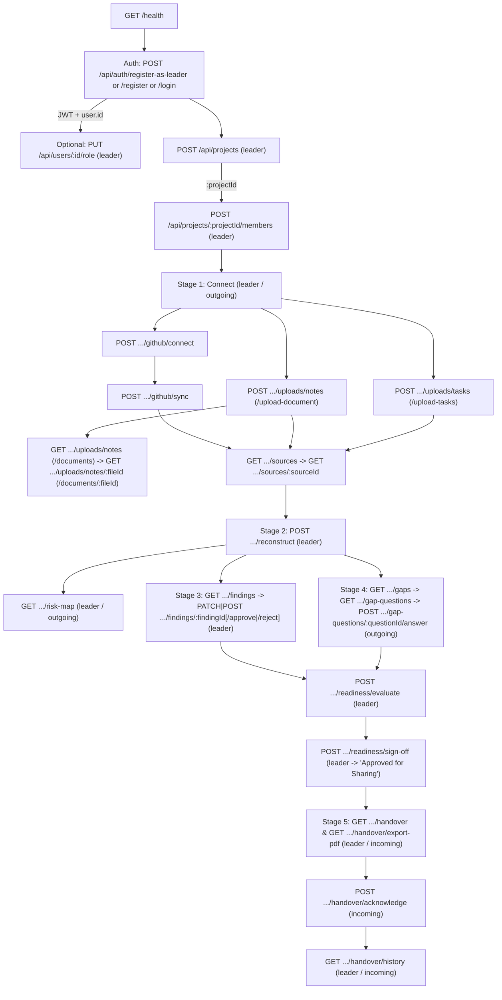

# Sanchaya Backend API Usage & Navigation Workflow

> **Base URL:** `http://localhost:5000` (configurable via `PORT` in `.env`)  
> **Authentication:** Pass the JWT returned by login/registration either in `Authorization: Bearer <token>` or via the `HttpOnly` cookie `token`.

---

## 1. End-to-End Navigation Flow

---

## 2. Step-by-Step Navigation by User Role

### A. Team Leader Journey (`role: "leader"`)

1. **Authenticate & Onboard Team**
   - `POST /api/auth/register-as-leader` (or `POST /api/auth/login`) → returns `{ token, user: { id, name, email, role } }` and sets the `token` cookie.
   - *(Optional)* `GET /api/auth/me` → verify current authenticated identity `{ id, email, role }`.
   - Have team members register via `POST /api/auth/register` (all standard registrations start as `"incoming"`).
   - Promote the departing member via `PUT /api/users/:id/role` with `{ "role": "outgoing" }` (leaders cannot modify their own role; `403`).

2. **Create Workspace & Assign Members**
   - `POST /api/projects` (`{ name, description?, githubRepo? }`) → returns the created project and its `_id` (`:projectId`).
   - `POST /api/projects/:projectId/members` (`{ outgoingIds?, incomingIds? }`) → binds outgoing and incoming members to the workspace.
   - `GET /api/projects` and `GET /api/projects/:projectId` → list all projects the user belongs to or inspect populated member details.

3. **Stage 1 — Connect & Inspect Sources**
   - **GitHub ingestion:**
     1. `POST /api/projects/:projectId/github/connect` (`{ repo, accessToken? }`) → verifies read-only access and saves `project.githubRepo`.
     2. `POST /api/projects/:projectId/github/sync` (`{ githubRepo?, token? }`) → fetches commits/PRs/issues, runs `scanAndRedact`, upserts `SRC-GH-*` records, and marks `readinessChecklist.sourcesVerified = true`.
   - **File uploads (`multipart/form-data`, field `"file"`):**
     - `POST /api/projects/:projectId/uploads/notes` (aliased at `/upload-document`) → extracts text from `.pdf`, `.docx`, or `.txt`, runs `scanAndRedact`, uploads the document to ImageKit in `/sanchaya/<projectId>`, and persists a `SRC-DOC-*` `SourceRecord` with ImageKit metadata (`url`, `fileId`, `filePath`), returning `{ id, source_id, origin, redactionCount, fileId, fileUrl, filePath, created_at }`.
     - `POST /api/projects/:projectId/uploads/tasks` (aliased at `/upload-tasks`) → ingests `.csv` as `SRC-TSK-*`.
   - **Fetch stored documents (ImageKit) & inspect ingested records:**
     - `GET /api/projects/:projectId/uploads/notes` (aliased at `/documents`) → lists document files stored in `/sanchaya/<projectId>/` on ImageKit.
     - `GET /api/projects/:projectId/uploads/notes/:fileId` (aliased at `/documents/:fileId`) → fetches metadata and delivery URL for a single document on ImageKit (enforces `/sanchaya/<projectId>/` folder isolation; returns `404` otherwise).
     - `GET /api/projects/:projectId/sources` (optional `?type=github|document|task`) → returns metadata and canonical `source_id`s without large `redacted_content` blobs.
     - `GET /api/projects/:projectId/sources/:sourceId` → fetches the full `SourceRecord` including `redacted_content`.

4. **Stage 2 — Reconstruct Knowledge & Concentration Risk**
   - `POST /api/projects/:projectId/reconstruct` → triggers `ai-engine` (`/internal/extract-and-verify`) to extract candidate claims, run deterministic 4-state verification (`Supported`, `Needs review`, `Conflicting`, `Unknown`), compute freshness, and generate gap questions.
   - `GET /api/projects/:projectId/risk-map` → retrieves the Contribution Concentration Risk Map from `analytics-service`.

5. **Stage 3 & 4 — Curate Findings, Review Gaps & Sign Off**
   - `GET /api/projects/:projectId/findings` → lists candidate findings (`:findingId`).
   - Curate findings:
     - `PATCH /api/projects/:projectId/findings/:findingId` → edit `claim`, `category`, or `review_status`.
     - `POST /api/projects/:projectId/findings/:findingId/approve` → approve finding and mark `readinessChecklist.decisionsBackedByEvidence = true`.
     - `POST /api/projects/:projectId/findings/:findingId/reject` → exclude finding from handover.
   - Monitor knowledge gaps:
     - `GET /api/projects/:projectId/gaps` → view `Unknown`/`Conflicting`/`blocker` findings and pending questions.
     - `GET /api/projects/:projectId/gap-questions` → review all questions and outgoing member answers.
   - Evaluate & sign off:
     - `POST /api/projects/:projectId/readiness/evaluate` → runs `analytics-service` evaluation.
     - `GET /api/projects/:projectId/readiness` → inspect the 7-point checklist and current `readinessStatus`.
     - `POST /api/projects/:projectId/readiness/sign-off` (`{ checklistUpdates? }`) → sets `leaderApprovalRecorded = true`; if all 7 checklist booleans are `true`, transitions `readinessStatus` to `"Approved for Sharing"` (otherwise returns `400` with `"Ready for Review"`).

6. **Stage 5 — Verify Final Handover**
   - `GET /api/projects/:projectId/handover` → inspect final approved findings and answered/approved gap answers.
   - `GET /api/projects/:projectId/handover/export-pdf` → download the ReportLab PDF handover package.
   - `GET /api/projects/:projectId/handover/history` → check incoming member acknowledgement logs.

---

### B. Outgoing Member Journey (`role: "outgoing"`)

1. **Authenticate & Locate Project**
   - `POST /api/auth/login` → `GET /api/projects` (obtain `:projectId`) → `GET /api/projects/:projectId`.
2. **Stage 1 — Connect Sources**
   - Same Stage 1 access as leader: `POST .../github/connect`, `POST .../github/sync`, `POST .../uploads/notes` (`/upload-document`), `POST .../uploads/tasks` (`/upload-tasks`), `GET .../uploads/notes` (`/documents`), `GET .../uploads/notes/:fileId` (`/documents/:fileId`), `GET .../sources`, and `GET .../sources/:sourceId`.
3. **Stage 2–4 — Inspect Findings & Close Knowledge Gaps**
   - Read-only inspection: `GET .../risk-map`, `GET .../findings`, and `GET .../readiness`.
   - Answer targeted gap questions (exclusive to `"outgoing"`):
     1. `GET /api/projects/:projectId/gaps` → identify unresolved items.
     2. `GET /api/projects/:projectId/gap-questions` → pick a pending `:questionId`.
     3. `POST /api/projects/:projectId/gap-questions/:questionId/answer` (`{ answer }`) → saves the response with `evidence_badge: "Self-reported"` and updates any linked finding with `evidence_origin: "self_reported"` and `verification_status: "Supported"`.
   - *Restricted (`403 Forbidden`):* Cannot trigger `/reconstruct`, edit/approve/reject findings, run `/readiness/evaluate` or `/readiness/sign-off`, or access Stage 5 `/handover*` routes.

---

### C. Incoming Member Journey (`role: "incoming"`)

1. **Authenticate & Poll Readiness**
   - `POST /api/auth/register` (or `POST /api/auth/login`) → `GET /api/projects` → `GET /api/projects/:projectId` → `GET /api/projects/:projectId/readiness`.
   - **Hard Isolation Gate:** All Stages 1–4 routes (`/github/*`, `/uploads/*`, `/documents*`, `/sources*`, `/reconstruct`, `/risk-map`, `/findings*`, `/gaps`, `/gap-questions*`) return `403 Forbidden`. Stage 5 `/handover*` routes also return `403 Forbidden` until `readinessStatus === "Approved for Sharing"`.
2. **Stage 5 — Consume, Export & Acknowledge Handover**
   - Once `readinessStatus` is `"Approved for Sharing"`:
     1. `GET /api/projects/:projectId/handover` → read approved findings and `Self-reported` gap answers.
     2. `GET /api/projects/:projectId/handover/export-pdf` → download the PDF report.
     3. `POST /api/projects/:projectId/handover/acknowledge` (exclusive to `"incoming"`) → records an immutable `HandoverHistory` acknowledgement snapshot.
     4. `GET /api/projects/:projectId/handover/history` → view recorded acknowledgement receipts.

---

### D. Password Recovery Flow (Any Role)

1. `POST /api/auth/forgot-password` (`{ email }`) → generates a 15-minute reset token (returned directly in `data.resetToken` when `NODE_ENV !== "production"`).
2. `POST /api/auth/reset-password` (`{ token, newPassword }`) → updates `passwordHash`, clears reset fields, and stamps `passwordChangedAt` (invalidating all previously issued JWTs).
3. `POST /api/auth/login` → obtain a fresh JWT.

---

## 3. Complete Route & RBAC Reference

| Stage | Method & Path | Allowed Roles | Purpose / Gate |
| :--- | :--- | :--- | :--- |
| System | `GET /health` | Public | Gateway healthcheck |
| Auth | `POST /api/auth/register` | Public | Self-register as `"incoming"` + auto-login JWT |
| Auth | `POST /api/auth/register-as-leader` | Public | Self-register as `"leader"` + auto-login JWT |
| Auth | `POST /api/auth/login` | Public | Email/password login + JWT cookie |
| Auth | `GET /api/auth/me` | Any authenticated | Return current JWT user claims |
| Auth | `POST /api/auth/forgot-password` | Public | Generate password reset token |
| Auth | `POST /api/auth/reset-password` | Public | Apply password reset + invalidate old JWTs |
| Users | `PUT /api/users/:id/role` | `leader` | Promote/demote another user (`403` on self) |
| Workspace | `POST /api/projects` | `leader` | Create project workspace |
| Workspace | `GET /api/projects` | Any authenticated | List projects where user is a member |
| Workspace | `GET /api/projects/:projectId` | Any authenticated | Get project with populated members |
| Workspace | `POST /api/projects/:projectId/members` | `leader` | Assign `outgoingIds` and `incomingIds` |
| Stage 1 | `POST /api/projects/:projectId/github/connect` | `leader`, `outgoing` | Verify & bind GitHub repo |
| Stage 1 | `POST /api/projects/:projectId/github/sync` | `leader`, `outgoing` | Ingest commits/PRs/issues with redaction |
| Stage 1 | `POST /api/projects/:projectId/uploads/notes` (`/upload-document`) | `leader`, `outgoing` | Ingest PDF/DOCX/TXT notes with redaction & store in ImageKit `/sanchaya/<projectId>` |
| Stage 1 | `GET /api/projects/:projectId/uploads/notes` (`/documents`) | `leader`, `outgoing` | List documents stored in ImageKit `/sanchaya/<projectId>/` |
| Stage 1 | `GET /api/projects/:projectId/uploads/notes/:fileId` (`/documents/:fileId`) | `leader`, `outgoing` | Fetch single ImageKit document details & URL (folder-scoped) |
| Stage 1 | `POST /api/projects/:projectId/uploads/tasks` (`/upload-tasks`) | `leader`, `outgoing` | Ingest CSV task tracker with redaction |
| Stage 1 | `GET /api/projects/:projectId/sources` | `leader`, `outgoing` | List `SRC-*` records (without blobs) |
| Stage 1 | `GET /api/projects/:projectId/sources/:sourceId` | `leader`, `outgoing` | Get single `SRC-*` record with `redacted_content` |
| Stage 2 | `POST /api/projects/:projectId/reconstruct` | `leader` | Trigger `ai-engine` extraction & verification |
| Stage 2 | `GET /api/projects/:projectId/risk-map` | `leader`, `outgoing` | Fetch risk map from `analytics-service` |
| Stage 3 | `GET /api/projects/:projectId/findings` | `leader`, `outgoing` | Inspect candidate findings |
| Stage 3 | `PATCH /api/projects/:projectId/findings/:findingId` | `leader` | Edit finding properties / review status |
| Stage 3 | `POST /api/projects/:projectId/findings/:findingId/approve` | `leader` | Approve finding for handover |
| Stage 3 | `POST /api/projects/:projectId/findings/:findingId/reject` | `leader` | Reject finding from handover |
| Stage 4 | `GET /api/projects/:projectId/gaps` | `leader`, `outgoing` | View unresolved findings + pending questions |
| Stage 4 | `GET /api/projects/:projectId/gap-questions` | `leader`, `outgoing` | List all gap questions |
| Stage 4 | `POST /api/projects/:projectId/gap-questions/:questionId/answer` | `outgoing` | Submit `Self-reported` answer |
| Stage 4 | `GET /api/projects/:projectId/readiness` | Any authenticated | Check 7-point checklist & `readinessStatus` |
| Stage 4 | `POST /api/projects/:projectId/readiness/evaluate` | `leader` | Trigger `analytics-service` readiness evaluation |
| Stage 4 | `POST /api/projects/:projectId/readiness/sign-off` | `leader` | Sign off checklist (`"Approved for Sharing"`) |
| Stage 5 | `GET /api/projects/:projectId/handover` | `leader`, `incoming`* | Get final approved handover report |
| Stage 5 | `GET /api/projects/:projectId/handover/export-pdf` | `leader`, `incoming`* | Stream ReportLab PDF export |
| Stage 5 | `POST /api/projects/:projectId/handover/acknowledge` | `incoming`* | Record handover receipt acknowledgement |
| Stage 5 | `GET /api/projects/:projectId/handover/history` | `leader`, `incoming`* | View acknowledgement snapshots & logs |

*\*For `"incoming"` users, Stage 5 routes require `project.readinessStatus === "Approved for Sharing"` (otherwise `403 Forbidden`).*

